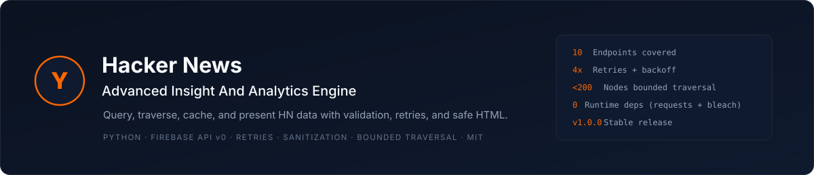
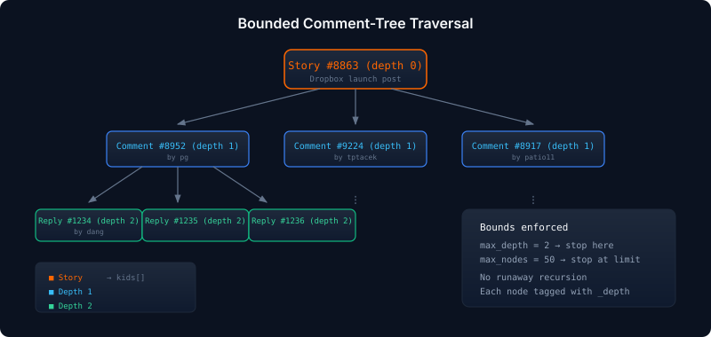
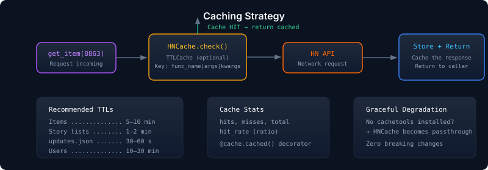

<p align="center">
  
</p>

<p align="center">
  <a href="https://github.com/Reda3D/Hacker-News-Advanced-Insight-And-Analytics-Engine/actions/workflows/ci.yml"></a>
  
  
  
  <a href="https://github.com/Reda3D/Hacker-News-Advanced-Insight-And-Analytics-Engine/releases"></a>
</p>

<p align="center">
  <b>A production-grade skill for querying, traversing, caching, and presenting
  Hacker News public data through the Firebase v0 API.</b><br>
  <sub>Validation, retries, timeouts, safe HTML rendering, and bounded comment-tree traversal.</sub>
</p>

---

## Table of Contents

1. [Overview](#overview)
2. [Why This Skill](#why-this-skill)
3. [Architecture](#architecture)
4. [Features](#features)
5. [Installation](#installation)
6. [Quick Start](#quick-start)
7. [API Reference](#api-reference)
   - [Items](#items)
   - [Users](#users)
   - [Live Data](#live-data)
8. [Bounded Comment-Tree Traversal](#bounded-comment-tree-traversal)
9. [Robustness & Error Handling](#robustness--error-handling)
10. [Security & HTML Sanitization](#security--html-sanitization)
11. [Caching Strategy](#caching-strategy)
12. [Usage Examples](#usage-examples)
13. [Project Structure](#project-structure)
14. [Best Practices](#best-practices)
15. [Limitations](#limitations)
16. [Contributing](#contributing)
17. [License](#license)

---

## Overview

**Hacker News Advanced Insight And Analytics Engine** is a technical skill that wraps the public [Hacker News Firebase API v0](https://github.com/HackerNews/API) into a clean, resilient, and well-documented toolkit.

It is designed for:

- **Agents and LLM tools** that need reliable access to HN data.
- **Data engineers** building story/comment analytics.
- **Dashboard developers** that need bounded, cached, and safe fetches.
- **Researchers** who want reproducible access to HN snapshots.

The base URL is:
```
https://hacker-news.firebaseio.com/v0
```

There is currently **no documented rate limit**, but this skill still enforces retries, exponential backoff, timeouts, and caching to remain a good citizen of the API.

---

## Why This Skill

The raw HN API is a **direct dump of in-memory data structures**. It is awkward by design:

- Counting comments on a story means traversing the whole tree.
- Listing children means loading the parent, then loading each child.
- No pagination, no projections, no filtering.
- HTML fields are raw and must be sanitized before rendering.

This skill solves those problems by providing:

- Validated, typed wrappers around every endpoint.
- A **bounded** comment-tree traversal (no runaway recursion).
- A clear **HTML sanitization** policy.
- A documented **caching strategy**.
- A **retry + backoff + timeout** network layer.
- Deterministic error types for upstream failures.

---

## Architecture

<p align="center">
  
</p>

The engine follows a layered architecture:

| Layer | Responsibility |
|---|---|
| **HN Firebase API v0** | The upstream data source — direct in-memory dump. |
| **HNClient** | HTTP layer with retries (4×), exponential backoff, 10s timeout, and a structured error hierarchy. |
| **Modules** | `items` (fetch + tree traversal), `users` (profiles), `lists` (story IDs + updates + maxitem), `sanitize` (HTML allow-list), `cache` (TTL with graceful degradation). |
| **Output** | Typed dictionaries, safe HTML, structured exceptions, and ready-to-use reports. |

---

## Features

- ✅ Full coverage of the v0 endpoints: `item`, `user`, `maxitem`, `topstories`, `newstories`, `beststories`, `askstories`, `showstories`, `jobstories`, `updates`.
- ✅ Strict input validation (`int` vs `bool`, positive IDs, non-empty usernames).
- ✅ Case-sensitive username handling with URL encoding.
- ✅ Graceful handling of `null` responses (deleted or unknown items/users).
- ✅ Bounded comment-tree traversal (`max_depth`, `max_nodes`).
- ✅ HTML sanitization with an explicit allow-list.
- ✅ Retry with exponential backoff for 429/5xx and transient network errors.
- ✅ Structured `HNError` exception hierarchy with clear context.
- ✅ Optional TTL caching with `cachetools` (graceful no-op fallback).
- ✅ Ready for integration into agents, pipelines, and dashboards.

---

## Installation

```bash
pip install requests bleach
```

Optional, for caching:

```bash
pip install cachetools
```

Or install the full development bundle:

```bash
pip install -e ".[dev,cache]"
```

---

## Quick Start

```python
from hn_engine import get_item, get_story_ids, get_comment_tree

# Fetch a single story
story = get_item(8863)
print(story["title"])
print(story["score"], "points by", story["by"])

# Fetch the current top story IDs (up to 500)
top_ids = get_story_ids("top")
print(len(top_ids), "top stories available")

# Bounded comment-tree traversal
tree = get_comment_tree(8863, max_depth=2, max_nodes=50)
print(len(tree), "nodes fetched")
```

---

## API Reference

### Items

Stories, comments, jobs, Ask HNs and polls are all **items**, identified by unique integer IDs.

**Endpoint:** `/v0/item/<id>.json`

| Field | Description |
|---|---|
| `id` | Required. The item's unique id. |
| `deleted` | `true` if the item is deleted. |
| `type` | One of `job`, `story`, `comment`, `poll`, `pollopt`. |
| `by` | Username of the author. |
| `time` | Creation date, Unix time. |
| `text` | Comment, story or poll text. HTML. |
| `dead` | `true` if the item is dead. |
| `parent` | Parent comment or story ID. |
| `poll` | Associated poll ID (for pollopts). |
| `kids` | Comment IDs, in ranked display order. |
| `url` | Story URL. |
| `score` | Story score, or pollopt votes. |
| `title` | Story, poll or job title. HTML. |
| `parts` | Related pollopt IDs, in display order. |
| `descendants` | Total comment count for stories or polls (not for comments). |

**Example — story 8863:**

```json
{
  "by": "dhouston",
  "descendants": 71,
  "id": 8863,
  "kids": [8952, 9224, 8917, 8884, 8887, 8943, 8869, 8958, 9005, 9671],
  "score": 111,
  "time": 1175714200,
  "title": "My YC app: Dropbox - Throw away your USB drive",
  "type": "story",
  "url": "http://www.getdropbox.com/u/2/screencast.html"
}
```

**Example — comment 2921983:**

```json
{
  "by": "norvig",
  "id": 2921983,
  "kids": [2922097, 2922429, 2924562],
  "parent": 2921506,
  "text": "Aw shucks, guys ... you make me blush with your compliments.",
  "time": 1314211127,
  "type": "comment"
}
```

**Item types at a glance:**

| Type | Has title | Has text | Has kids | Has url | Has parts |
|---|---|---|---|---|---|
| story | ✅ | ✅ | ✅ | ✅ | ❌ |
| ask | ✅ | ✅ | ✅ | ❌ | ❌ |
| job | ✅ | ✅ | ❌ | ✅ | ❌ |
| comment | ❌ | ✅ | ✅ | ❌ | ❌ |
| poll | ✅ | ✅ | ✅ | ❌ | ✅ |
| pollopt | ❌ | ✅ | ❌ | ❌ | ❌ |

### Users

Users are identified by case-sensitive usernames and live under `/v0/user/`. Only users with public activity are exposed.

**Endpoint:** `/v0/user/<username>.json`

| Field | Description |
|---|---|
| `id` | Required. Case-sensitive username. |
| `created` | Creation date, Unix time. |
| `karma` | User karma. |
| `about` | Optional self-description. HTML. |
| `submitted` | List of story, poll and comment IDs. |

**Example — user `jl`:**

```json
{
  "about": "This is a test",
  "created": 1173923446,
  "id": "jl",
  "karma": 2937,
  "submitted": [8265435, 8168423, 8090946, 8090326, 7699907]
}
```

> ⚠️ `submitted` can be very large. Never fetch every submitted item blindly — apply pagination or filtering in your own code.

### Live Data

#### Max Item ID

**Endpoint:** `/v0/maxitem.json`

Returns the largest item ID currently known. Useful for tailing new items backward.

```json
9130260
```

#### Story Lists

| Kind | Endpoint | Limit |
|---|---|---|
| top | `/v0/topstories.json` | 500 |
| new | `/v0/newstories.json` | 500 |
| best | `/v0/beststories.json` | 500 |
| ask | `/v0/askstories.json` | 200 |
| show | `/v0/showstories.json` | 200 |
| job | `/v0/jobstories.json` | 200 |

Each endpoint returns an array of IDs (not full items):

```json
[9129911, 9129199, 9127761, 9128141, 9128264]
```

#### Changed Items and Profiles

**Endpoint:** `/v0/updates.json`

```json
{
  "items": [8423305, 8420805, 8423379],
  "profiles": ["thefox", "mdda", "plinkplonk"]
}
```

This is the recommended way to build an **incremental sync loop**:

1. Poll `/v0/updates.json` every 30–60 seconds.
2. For each changed item ID, refresh the cached item.
3. For each changed profile, refresh the cached user.

---

## Bounded Comment-Tree Traversal

<p align="center">
  
</p>

HN comment trees can be **enormous** — deeply nested, with hundreds or thousands of nodes. This engine provides `get_comment_tree()` with two hard bounds:

- **`max_depth`** — Stop descending after N levels (0 = root only).
- **`max_nodes`** — Stop fetching after N total nodes.

Every returned node includes a `_depth` key so you know exactly where it sits in the tree.

```python
from hn_engine import get_comment_tree, sanitize_html

tree = get_comment_tree(8863, max_depth=2, max_nodes=50)

for node_id, node in tree.items():
    if node.get("type") != "comment":
        continue
    depth = node["_depth"]
    text = sanitize_html(node.get("text", ""))
    print(f"{'  ' * depth}#{node_id}: {text[:80]}...")
```

---

## Robustness & Error Handling

The engine enforces the following rules:

1. **Input validation** — `item_id` must be a positive `int` (booleans are explicitly rejected).
2. **Retries** — up to 4 attempts with exponential backoff on 429, 500, 502, 503, 504, and transient network errors.
3. **Timeouts** — default 10 seconds per request.
4. **Deterministic errors** — every failure raises `HNError` with a clear message including the failing URL and HTTP status.
5. **Graceful null** — missing or deleted items/users return `None`, never throw.
6. **Bounded traversal** — `get_comment_tree` requires `max_depth` and `max_nodes`.

### Exception Hierarchy

```
HNError (base)
├── ValidationError   → bad input, not retryable
├── NetworkError      → connection/timeout, retryable
├── RateLimitError    → HTTP 429, retryable, carries retry_after
└── NotFoundError     → HTTP 404 or null response, not retryable
```

Example:

```python
from hn_engine.errors import HNError, RateLimitError

try:
    story = get_item(8863)
except RateLimitError as exc:
    print(f"Rate limited. Retry after {exc.retry_after}s")
except HNError as exc:
    print(f"Failed: {exc}")
```

---

## Security & HTML Sanitization

`text`, `title`, and `about` fields contain raw HTML. Always sanitize them before display, logging, or embedding in a UI.

### Recommended allow-list

| Element | Attributes |
|---|---|
| `p`, `br` | — |
| `i`, `em` | — |
| `b`, `strong` | — |
| `a` | `href`, `rel` |
| `pre`, `code` | — |
| `ul`, `ol`, `li` | — |
| `blockquote` | — |

**Protocols:** `http`, `https`, `mailto` only.

```python
from hn_engine import sanitize_html

clean = sanitize_html('<a href="http://example.com">link</a><script>evil()</script>')
# → '<a href="http://example.com">link</a>'
```

If `bleach` is not installed, the sanitizer degrades gracefully to a tag-stripping fallback — no breaking changes.

---

## Caching Strategy

<p align="center">
  
</p>

| Resource | Suggested TTL |
|---|---|
| Items | 5–10 min |
| Story lists | 1–2 min |
| `updates.json` | 30–60 s |
| Users | 10–30 min |
| `maxitem.json` | 1 min |

The `HNCache` class wraps `cachetools.TTLCache` when available, or degrades to a no-op passthrough otherwise.

```python
from hn_engine import HNCache, get_item

cache = HNCache(maxsize=1024, ttl=300.0)

@cache.cached(ttl=120)
def fetch_story(story_id: int):
    return get_item(story_id)

story = fetch_story(8863)   # cache miss → API call
story = fetch_story(8863)   # cache hit → instant return

print(cache.stats)
# → {'hits': 1, 'misses': 1, 'total': 2, 'hit_rate': 0.5}
```

> ⚠️ Never cache `null` responses indefinitely — the resource may appear later.

---

## Usage Examples

### 1. Top 10 stories with sanitized titles

```python
from hn_engine import get_story_ids, get_item, sanitize_html, StoryKind

top_ids = get_story_ids(StoryKind.TOP, limit=10)

for item_id in top_ids:
    item = get_item(item_id)
    if item is None:
        continue
    title = sanitize_html(item.get("title", ""))
    print(f"[{item.get('score', 0):>4}] {title}")
```

### 2. Bounded comment tree

```python
from hn_engine import get_comment_tree, sanitize_html

tree = get_comment_tree(8863, max_depth=2, max_nodes=100)

for node_id, node in tree.items():
    if node.get("type") != "comment":
        continue
    text = sanitize_html(node.get("text", ""))
    print(f"#{node_id} by {node.get('by')}: {text[:80]}...")
```

### 3. Incremental sync loop

```python
import time
from hn_engine import get_updates, get_item

seen_items: set[int] = set()

while True:
    updates = get_updates()
    for item_id in updates["items"]:
        if item_id in seen_items:
            continue
        item = get_item(item_id)
        if item is None:
            continue
        seen_items.add(item_id)
        print("Refreshed item", item_id, "type=", item.get("type"))
    time.sleep(45)
```

### 4. Detect new items via maxitem

```python
from hn_engine import get_maxitem

last_seen = get_maxitem()

# ... later ...
current = get_maxitem()
new_ids = list(range(current, last_seen, -1))
print(f"{len(new_ids)} new items appeared")
```

### 5. Fetch user karma

```python
from hn_engine import get_user

user = get_user("jl")
if user:
    print(f"@{user['id']} — karma: {user['karma']}")
```

More examples in the [`examples/`](examples/) directory:

| Example | Description |
|---|---|
| [`01_top_stories.py`](examples/01_top_stories.py) | Fetch and display top stories with metadata. |
| [`02_comment_tree.py`](examples/02_comment_tree.py) | Traverse a bounded comment tree. |
| [`03_incremental_sync.py`](examples/03_incremental_sync.py) | Poll `updates.json` in a loop. |
| [`04_maxitem_and_user.py`](examples/04_maxitem_and_user.py) | Detect new items and fetch user profiles. |
| [`05_caching.py`](examples/05_caching.py) | Use the TTL cache decorator. |

---

## Project Structure

```
Hacker-News-Advanced-Insight-And-Analytics-Engine/
├── hn_engine/
│   ├── __init__.py          # Public API exports
│   ├── client.py            # HNClient: retries, backoff, timeout
│   ├── items.py             # get_item, get_comment_tree, item_type_traits
│   ├── users.py             # get_user
│   ├── lists.py             # get_story_ids, get_updates, get_maxitem
│   ├── sanitize.py          # sanitize_html with allow-list
│   ├── cache.py             # HNCache: TTL with graceful degradation
│   └── errors.py            # Exception hierarchy
├── examples/
│   ├── 01_top_stories.py
│   ├── 02_comment_tree.py
│   ├── 03_incremental_sync.py
│   ├── 04_maxitem_and_user.py
│   └── 05_caching.py
├── tests/
│   ├── test_errors.py
│   ├── test_client.py
│   ├── test_items_validation.py
│   ├── test_lists.py
│   ├── test_sanitize.py
│   ├── test_cache.py
│   └── test_integration.py
├── assets/
│   ├── banner.svg
│   ├── architecture.svg
│   ├── comment-tree.svg
│   └── caching.svg
├── .github/workflows/ci.yml
├── pyproject.toml
├── README.md
└── LICENSE
```

---

## Best Practices

- **Do** bound every traversal (`max_depth`, `max_nodes`).
- **Do** sanitize every HTML field before rendering.
- **Do** cache aggressively — the API is read-heavy.
- **Do** ignore unknown fields — the API may add fields without warning.
- **Do** URL-encode usernames — they are case-sensitive.
- **Don't** rely on `descendants` for comment-level counts.
- **Don't** recurse unboundedly over `kids`.
- **Don't** assume `null` means "deleted forever" — the item may reappear.

---

## Limitations

- The API has no pagination and no filtering.
- Comment counts require manual traversal.
- No guaranteed rate limit means a well-behaved client should self-throttle.
- Some items may return `null` even when they exist (deleted / dead).
- `submitted` on active users can contain thousands of IDs.

---

## Contributing

Issues and pull requests are welcome. Please:

1. Follow PEP 8 and `ruff` formatting.
2. Add tests for any new endpoint wrapper.
3. Keep the sanitization allow-list conservative.
4. Document any new retry behavior.
5. Render and inspect any new SVG assets before committing.

Run the test suite:

```bash
# Unit tests (no network)
pytest -m "not integration" -v

# Integration tests (live API)
pytest -m integration -v

# Lint and type-check
ruff check hn_engine tests
mypy hn_engine
```

---

## License

MIT — see [LICENSE](LICENSE).
